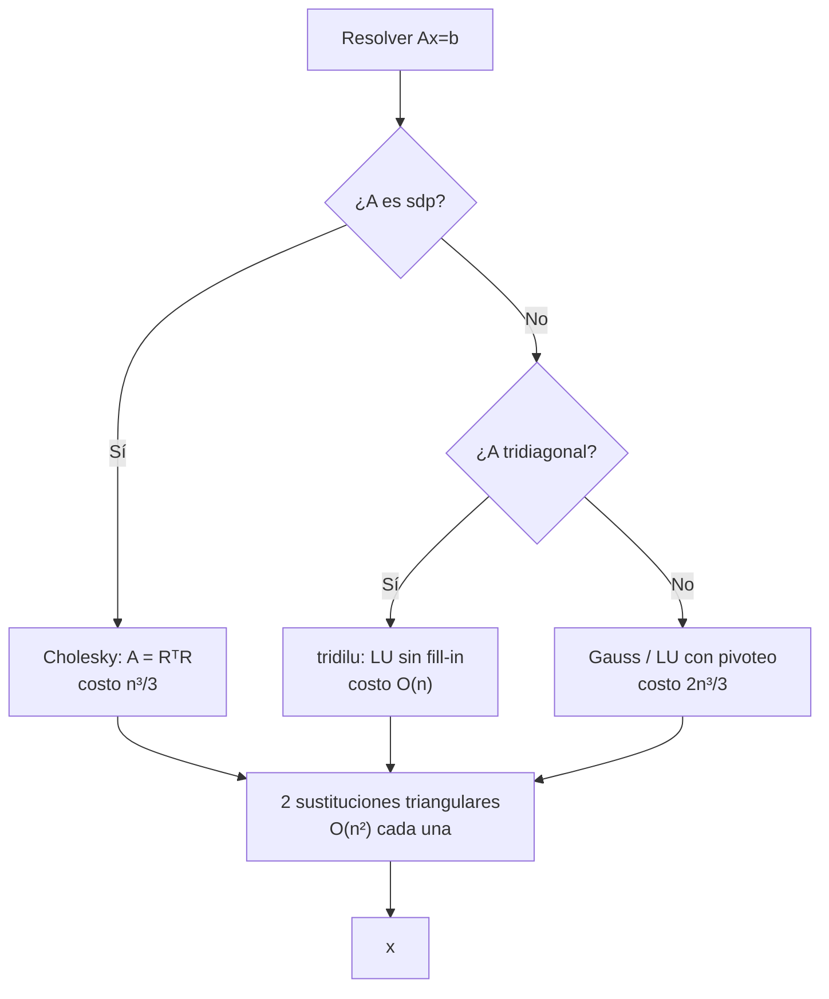
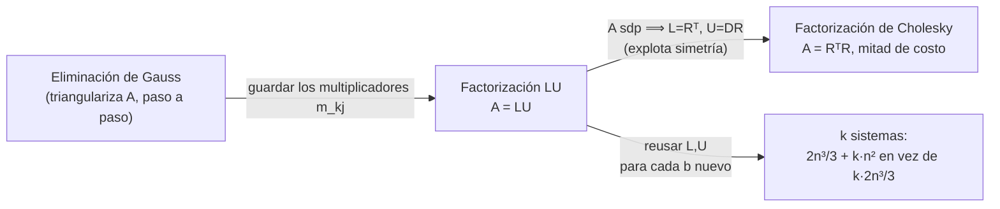

# Capítulo 2 - Métodos directos para sistemas lineales

> [!idea]
> Idea central del capítulo: resolver $Ax=b$ reduciendo $A$ a forma triangular (Gauss/[[Factorizacion LU|LU]]) o, si $A$ es sdp, a $R^TR$ ([[Factorizacion de Cholesky|Cholesky]]), y después resolver dos sistemas triangulares (baratos, $O(n^2)$). Todo el capítulo es, en el fondo, una sola pregunta: *¿cuándo y cómo se puede triangular $A$ de forma barata y estable?*

## Teoría

- [[Matrices triangulares - sustitucion]] - definición, sustitución hacia adelante/atrás, conteo $O(n^2)$.
- [[Metodo de Gauss - eliminacion]] - eliminación por filas, conteo $O(2n^3/3)$.
- [[Factorizacion LU]] - matrices de Gauss, existencia y unicidad, costo de reusar la factorización para varios lados derechos.
- [[Pivoteo y matrices de permutacion]] - por qué hace falta, pivoteo parcial vs. total, teorema $PA=LU$.
- [[Factorizacion de Cholesky]] - matrices sdp, teorema de existencia (demostración constructiva por inducción), relación con LU.
- [[Costo computacional metodos directos]] - tabla comparativa de todos los costos del capítulo.

## Qué método usar, según $A$

La pregunta que organiza todo el capítulo: cuanta más estructura tiene $A$ (simetría, banda), más barato sale triangularla. Ver [[Costo computacional metodos directos]] para los números exactos.

## Cómo se relacionan Gauss, LU y Cholesky

Gauss **es** el algoritmo; LU es Gauss **recordando** lo que hizo (los multiplicadores) para no repetir trabajo con otro $b$; Cholesky es LU **aprovechando** que, si $A$ es simétrica, $L$ y $U$ no son independientes.

## Problemas (2.1 a 2.14)

Ver [[Capitulo 2 - Problemas - Indice]].

## Teoremas y demostraciones

Ver [[Demostraciones - Capitulo 2]] (un archivo por teorema/propiedad, en `Teoremas/`).

## Conexiones con otros capítulos

- `\` de Julia usa estas ideas por detrás - ver [[Resolver sistemas lineales en Julia]] (Capítulo 1).
- Cholesky reaparece como **precondicionador de factorización incompleta** en el Capítulo 5 - ver [[Precondicionadores genericos]].
- El número de condición, apenas mencionado acá, se estudia en profundidad en el [[Capitulo 4 - MOC|Capítulo 4]].
- Las ecuaciones normales del Capítulo 3 ($A^TAx=A^Tb$) se resuelven, precisamente, con Cholesky.
