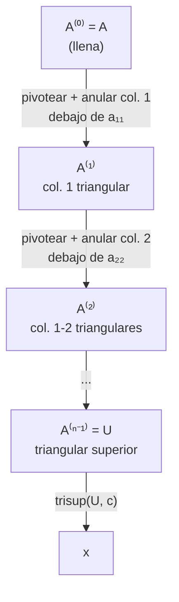

# Método de eliminación de Gauss

> [!idea]
> Restar múltiplos de una fila a las de abajo, columna por columna, hasta dejar $A$ triangular superior. Cuesta $O(2n³/3)$, el término dominante de resolver cualquier sistema denso.

## El algoritmo

En el paso $j$ ($j=1,…,n-1$), para cada fila $k>j$ se resta un múltiplo de la fila $j$ para anular la entrada $(k,j)$:
$$
\text{fila}_k(A^{(j)}) = \text{fila}_k(A^{(j-1)}) - \underbrace{\frac{a_{kj}^{(j-1)}}{a_{jj}^{(j-1)}}}_{m_{kj}}\text{fila}_j(A^{(j-1)}), \qquad k=j+1,\dots,n,
$$
y lo mismo sobre $b$. Al terminar el paso $n-1$, $A^{(n-1)}=U$ es triangular superior.

```julia
"""
    metodo_de_gauss(M, b)

Eliminación gaussiana con pivoteo parcial (reemplaza la fila j por la de
mayor |valor| en la columna j, antes de eliminar). Devuelve U, el lado
derecho ya transformado.
"""
function metodo_de_gauss(M::AbstractMatrix{T}, b::AbstractVector{T}) where T
    A = copy(M)
    c = copy(b)
    n = size(A, 1)
    for j in 1:n-1
        idx = argmax(abs.(@view A[j:n, j])) + j - 1     # pivoteo parcial
        A[j, :], A[idx, :] = A[idx, :], A[j, :]
        c[j], c[idx] = c[idx], c[j]
        for k in j+1:n
            m = A[k, j] / A[j, j]
            A[k, j:n] .-= m .* A[j, j:n]
            c[k] -= m * c[j]
        end
    end
    return A, c   # A es U; resolver con trisup(A, c)
end
```

## Cómo funciona, paso a paso



Cada paso $j$ solo toca las filas $k>j$ y columnas $\geq j$ (lo ya triangularizado no se vuelve a tocar) - por eso el costo decrece con cada paso ($n-j$ filas restantes), y la suma geométrica da el $2n^3/3$ total.

## Conteo de operaciones (ver [[Costo computacional metodos directos]] para la tabla completa)

Triangular $A$ cuesta
$$
\sum_{j=1}^{n-1}(1+2(n-j))(n-j) = \frac{2}{3}n^3-\frac{1}{2}n^2-\frac16n \cong \frac23n^3,
$$
y transformar $b$ cuesta $n²-n$. Sumando la sustitución hacia atrás final ($n²$), el total para resolver **un** sistema es
$$
\frac23n^3+\frac32n^2-\frac76n \cong \frac23n^3 \ \text{operaciones.}
$$

> [!idea]
> Este $2n³/3$ es *el* número a recordar del capítulo: es el costo de resolver un sistema denso genérico, y la vara con la que se comparan todos los métodos más baratos (tridiagonales $O(n)$, [[Factorizacion de Cholesky|Cholesky]] $n³/3$, etc.)

## Ver también
- [[Factorizacion LU]] (la misma cuenta, pero guardando los multiplicadores para reusarlos)
- [[Pivoteo y matrices de permutacion]]
