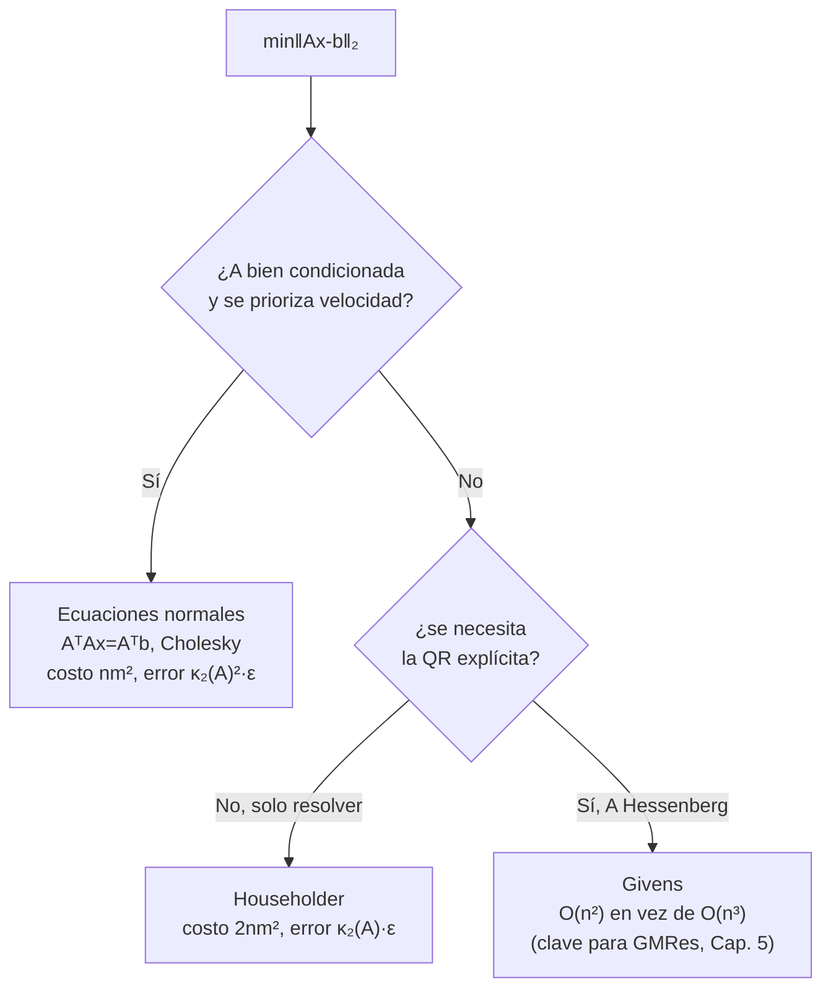
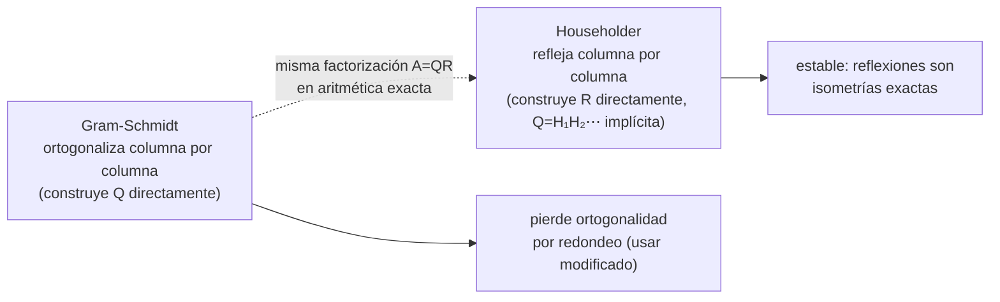

# Capítulo 3 - Factorización QR

> [!idea]
> Problema central: [[Minimos cuadrados y ecuaciones normales|mínimos cuadrados]], $min\|Ax-b\|_2$ con $A$ de $n×m$ ($n≥m$). Vía directa: ecuaciones normales $AᵀAx=Aᵀb$ (resolver con [[Factorizacion de Cholesky|Cholesky]]). Vía mejor: factorizar $A=QR$ con $Q$ ortogonal y $R$ triangular superior, y resolver $Rx=Qᵀb$ - más caro ($2nm²$ vs $nm²$) pero mucho más **estable**, porque multiplicar por [[Matrices ortogonales|matrices ortogonales]] no amplifica errores.

## Teoría

- [[Minimos cuadrados y ecuaciones normales]] - el problema, y por qué $AᵀAx=Aᵀb$.
- [[Matrices ortogonales]] - definición, propiedades ($Qx\cdot Qy=x\cdot y$, preservan norma).
- [[Ortogonalizacion de Gram-Schmidt]] - Teorema 3.5: construcción directa de $A=Q₁R₁$.
- [[Matrices de Householder]] - Teorema 3.9 y 3.13: reflexiones que anulan columnas, más estables que [[Ortogonalizacion de Gram-Schmidt|Gram-Schmidt]].
- [[Estabilidad y numero de condicion]] - por qué [[Matrices de Householder|Householder]] gana a las ecuaciones normales.
- [[Rotaciones de Givens]] - factorización QR económica para matrices Hessenberg (clave para [[GMRes - definicion y propiedad de minimizacion|GMRes]] en el Capítulo 5).

## Qué método usar para mínimos cuadrados

**La pregunta no es "¿cuál es mejor?"**, es "¿cuánto vale la pena pagar por estabilidad?" - ecuaciones normales eleva $\kappa_2(A)$ al cuadrado *antes* de resolver nada; Householder nunca amplifica nada porque son puras reflexiones (isometrías). Ver [[Estabilidad y numero de condicion]].

## Gram-Schmidt vs. Householder: la misma QR, construida al revés

## Problemas (3.1 a 3.7)

Ver [[Capitulo 3 - Problemas - Indice]].

## Teoremas y demostraciones

Ver [[Demostraciones - Capitulo 3]] (un archivo por teorema/propiedad, en `Teoremas/`).

## Conexiones con otros capítulos

- Las ecuaciones normales usan [[Factorizacion de Cholesky|Cholesky]] (Capítulo 2).
- Las [[Rotaciones de Givens|rotaciones de Givens]] reaparecen en el Capítulo 5 para la implementación final de [[GMRes - implementacion y rotaciones de Givens|GMRes]].
- El número de condición $κ₂(A)$, apenas introducido acá, se estudia en profundidad en el [[Capitulo 4 - MOC|Capítulo 4]].
