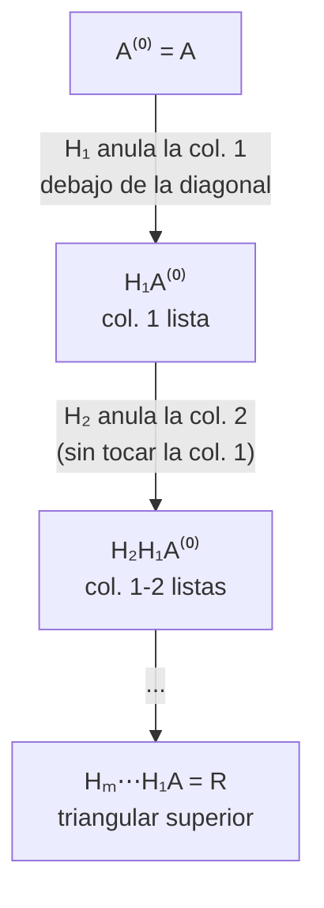

# Matrices de Householder

> [!idea]
> Una matriz de Householder $H=I-uu^T$ (con $\|u\|_2=\sqrt2$) es una **reflexión**: refleja cualquier vector respecto del hiperplano ortogonal a $u$. Eligiendo $u$ adecuadamente, $Hx$ se puede llevar exactamente a $\mp\|x\|_2 e_1$ - es decir, anular todas las componentes de $x$ salvo la primera, de un solo golpe. Encadenando $m$ de estas reflexiones se obtiene la factorización QR completa, y es **más estable** que [[Ortogonalizacion de Gram-Schmidt|Gram-Schmidt]] porque las reflexiones son isometrías exactas.

## Motivación geométrica (no está en el apunte, viene de las diapositivas)

Dado $w$ unitario, $P=I-ww^T$ **proyecta** sobre el hiperplano $\{v:w^Tv=0\}$. Para **reflejar** (en vez de proyectar) hay que restar el doble: $H=I-2ww^T$. Tomando $u=\sqrt2\,w$ (así $\|u\|_2=\sqrt2$), queda $H=I-uu^T$: exactamente la definición del apunte.

## Definición 3.7

$H=I-uu^T$ con $\|u\|_2=\sqrt2$ es una transformación de Householder.

## Propiedades (Observación 3.8)

- $H$ es simétrica (inmediato) y **ortogonal**: $H^TH=(I-uu^T)^2=I-2uu^T+u\underbrace{(u^Tu)}_{=2}u^T=I$.
- Calcular $HX$ sin ensamblar $H$ explícitamente: $HX=X-u(u^TX)$, que cuesta solo $4nk$ operaciones (en vez de $≅2n^2k$ armando $H$ y multiplicando), para $X\in\mathbb{R}^{n\times k}$.

## Teorema 3.9: construcción de $u$ para anular un vector

Si $\|x\|_2=1$, tomando $\sigma=\text{sgn}(x_1)$ y
$$
u = \frac{1}{\sqrt{1+\sigma x_1}}(x+\sigma e_1), \qquad H=I-uu^T,
$$
resulta $Hx=-\sigma e_1$. *(El signo se elige para que $1+\sigma x_1$ no sea chico - ver Observación 3.11.)* Si $\|x\|_2\neq1$ se normaliza antes: $Hx=-\sigma\|x\|_2e_1$. Demostración completa: [[Teorema 3.9]].

## Teorema 3.13: existencia de QR vía Householder

Si $A\in\mathbb{R}^{n\times m}$ tiene columnas li, existen $Q$ ortogonal y $R=\begin{bmatrix}R_1\\0\end{bmatrix}$ (con $R_1$ triangular superior no singular) tales que $A=QR$. Demostración completa (inducción en $m$, usando el Teorema 3.9 en cada paso): [[Teorema 3.13]].

## Cómo funciona, paso a paso



Igual que Gauss ([[Metodo de Gauss - eliminacion]]), pero en vez de restar múltiplos de una fila, cada paso **refleja** el vector columna restante hasta alinearlo con $e_1$ - nunca se arma $Q$ explícitamente, solo se guardan los $u_i$ (en `qrhouse`) y se aplican uno por uno (en `qrsolve`).

## Implementación (aplicando $H_1,H_2,\dots$ sucesivamente, sin ensamblar $Q$)

```julia
"""
    qrhouse(A)

Factorización QR por Householder. No arma Q: devuelve en las columnas de U
los vectores u que generan cada reflexión (Q^T = H_m⋯H_2H_1), y R.
"""
function qrhouse(A::AbstractMatrix{T}) where T
    n, m = size(A)
    R = copy(A)
    U = zeros(T, n, m)
    for i in 1:m
        normx = norm(@view R[i:n, i])
        u = R[i:n, i] / normx
        σ = u[1] >= 0 ? 1 : -1
        u[1] += σ
        u ./= sqrt(1 + σ * R[i, i] / normx)
        U[1:n-i+1, i] = u
        R[i, i] = -σ * normx
        R[i+1:n, i] .= 0
        @views R[i:n, i+1:m] .-= u * (u' * R[i:n, i+1:m])
    end
    return U, R
end

"""
    qrsolve(U, R, b)

Resuelve min‖Ax-b‖₂ usando la factorización (U,R) de qrhouse. Devuelve
la solución x y el error e=‖Ax-b‖₂.
"""
function qrsolve(U::AbstractMatrix{T}, R::AbstractMatrix{T}, b::AbstractVector{T}) where T
    n, m = size(U)
    c = copy(b)
    for i in 1:m
        u = U[1:n-i+1, i]
        c[i:n] .-= u .* (u' * c[i:n])
    end
    x = trisup(R[1:m, :], c[1:m])
    e = norm(@view c[m+1:n])
    return x, e
end
```

## Ver también
- [[Matrices ortogonales]]
- [[Estabilidad y numero de condicion]]
- [[3.4 - mincuadqr y ajuste polinomial|Problema 3.4]]
