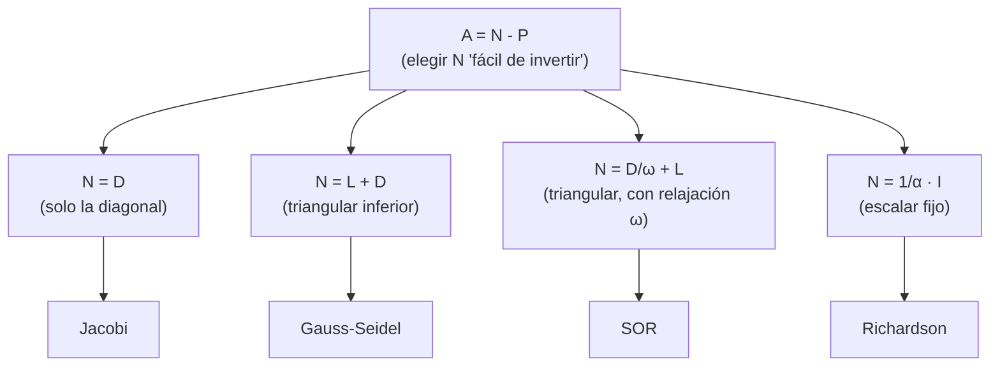

# Métodos iterativos estacionarios: marco general

> [!idea]
> Todos los métodos del capítulo ([[Metodo de Jacobi|Jacobi]], [[Metodo de Gauss-Seidel|Gauss-Seidel]], [[Metodo SOR|SOR]], [[Metodo de Richardson|Richardson]]) son casos particulares de $x_{k+1}=Mx_k+c$, con $M$ fija ("estacionaria", no cambia entre iteraciones). Lo único que cambia de un método a otro es **cómo se construye $M$ a partir de $A$**. Convergen $\iff\rho(M)<1$.

## De $Ax=b$ a una iteración de punto fijo

Escribiendo $A=L+D+U$ (triangular inferior estricta + diagonal + triangular superior estricta), la idea general es despejar una parte de $A$ y mandar el resto al lado derecho:
$$
Ax=b \iff x = \underbrace{(I-MA)}_{\text{reescribiendo}}x+Mb \iff x_{k+1}=Mx_k+c, \qquad c:=Mb,\ M:=I-MA \text{(abuso de notación, ver cada método)}.
$$

Más directo: si $A=N-P$ (cualquier descomposición con $N$ invertible "fácil de invertir"), entonces $Ax=b \iff Nx=Px+b \iff x=N^{-1}Px+N^{-1}b$, y la iteración es
$$
x_{k+1} = \underbrace{N^{-1}P}_{M}x_k + \underbrace{N^{-1}b}_{c}.
$$

## Convergencia

La iteración converge para todo $x_0$ $\iff\rho(M)<1$ (si $\rho(M)\geq1$, existe algún $x_0$ para el cual no converge, ver [[4.9 - No convergencia si rho mayor igual 1|Problema 4.9]]). Demostración completa: [[Teorema de convergencia de metodos iterativos estacionarios]].

**Condición suficiente más simple (pero no necesaria):** si existe alguna norma inducida con $‖M‖<1$, converge (porque $ρ(M)≤‖M‖<1$). Esto es lo que se usa para probar convergencia de Jacobi/Gauss-Seidel en [[2.11 - Matrices e.d.d. son no singulares|matrices e.d.d.]]

## Los 4 métodos son la misma receta, con $N$ distinto

Cuanto **más grande** (más de $A$) se mete en $N$, más caro es invertirlo por iteración, pero mejor converge: Jacobi invierte solo la diagonal (gratis, pero lento); Gauss-Seidel invierte un triangular (un poco más caro, converge mejor porque ya usa valores actualizados); SOR generaliza Gauss-Seidel con una perilla extra ($\omega$) para ajustar cuánto "confiar" en el paso nuevo.

## Tabla de los 4 métodos

Ver [[Comparacion metodos iterativos estacionarios]] para $M$, $c$, y las condiciones de convergencia de cada uno.

## Ver también
- [[Metodo de Jacobi]] · [[Metodo de Gauss-Seidel]] · [[Metodo SOR]] · [[Metodo de Richardson]]
- [[Espectro y radio espectral]]
