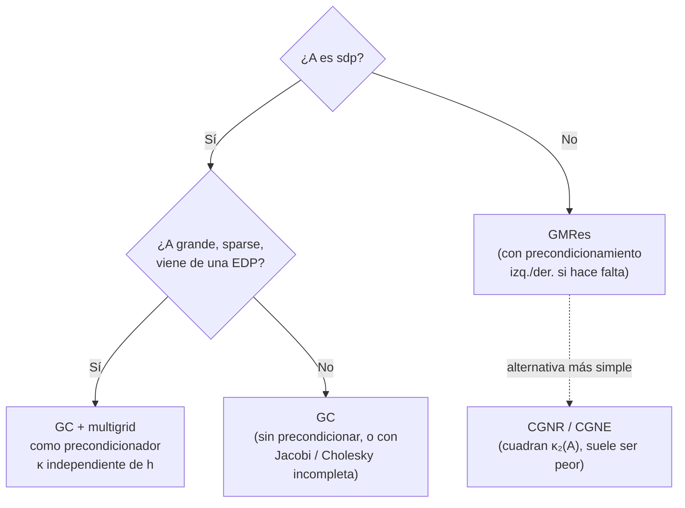
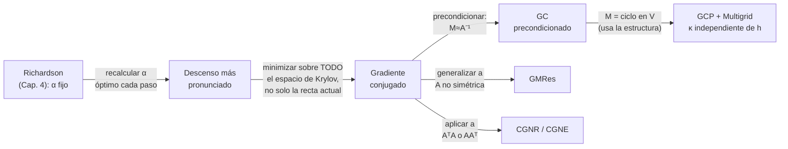

# Capítulo 5 - Métodos de descenso para sistemas lineales

> [!idea]
> Pregunta central: ¿se puede hacer mejor que un método iterativo estacionario (Capítulo 4), cambiando la dirección/el paso en cada iteración en vez de usar siempre la misma $M$? Respuesta: sí, y mucho - [[Gradiente conjugado - definicion y propiedades|gradiente conjugado]] converge en a lo sumo $n$ pasos y, bien precondicionado, es el método de referencia para sistemas sdp grandes. Para matrices no simétricas, [[GMRes - definicion y propiedad de minimizacion|GMRes]] generaliza la misma idea.

## Teoría - Gradiente conjugado ($A$ sdp)

- [[Funcional de energia y caracterizacion]] (5.1) - resolver $Ax=b$ = minimizar $\phi(x)=\frac12x^TAx-b^Tx$.
- [[Descenso mas pronunciado]] (5.2) - la primera idea, y por qué zigzaguea.
- [[Gradiente conjugado - definicion y propiedades]] (5.3) - residuos ortogonales, espacios de Krylov.
- [[Cotas de error del gradiente conjugado]] (5.4) - polinomios residuales, Chebyshev, $O(\sqrt{\kappa_2(A)})$ iteraciones.
- [[GC como metodo directo]] (5.4.1) - termina en $≤k$ pasos si $A$ tiene $k$ autovalores distintos.
- [[Implementacion del gradiente conjugado]] (5.5) - recurrencia de dos términos, algoritmo final económico.
- [[Precondicionamiento y GCP]] (5.6) - $SASy=Sb$, pero $S$ desaparece del algoritmo.
- [[Precondicionadores genericos]] (5.6.2) - [[Metodo de Jacobi|Jacobi]], [[Metodo de Gauss-Seidel|Gauss-Seidel]] simétrico, [[Factorizacion de Cholesky|Cholesky]] incompleta.
- [[Multigrid en 1D - problema modelo y suavizado]] (5.7.1–5.7.3)
- [[Multigrid en 1D - transferencia e implementacion]] (5.7.4–5.7.7) - multigrid como precondicionador óptimo ($O(1)$ iteraciones, independiente de $h$).

## Teoría - Matrices no simétricas

- [[Gradiente conjugado no simetrico - CGNR y CGNE]] (5.8)
- [[GMRes - definicion y propiedad de minimizacion]] (5.9.1–5.9.2)
- [[GMRes - precondicionamiento]] (5.9.3)
- [[GMRes - implementacion y rotaciones de Givens]] (5.9.4–5.9.5)

## Problemas (5.1 a 5.20)

Ver [[Capitulo 5 - Problemas - Indice]].

## Teoremas y demostraciones

Ver [[Demostraciones - Capitulo 5]] (un archivo por teorema/propiedad, en `Teoremas/`).

## Comparaciones centrales

Ver [[Tablas Comparativas - Indice]]: GC vs. SD, GC vs. GCP, GC vs. GMRes, precondicionadores genéricos vs. multigrid.

## El mapa de decisión del capítulo

## De dónde sale cada método (genealogía)

La columna de la izquierda ([[Metodo de Richardson|Richardson]]→SD→GC) es, cada paso, la misma idea de siempre: **dejar de fijar de antemano lo que el método anterior fijaba**, primero el paso ($α$), después la dirección (toda la base de Krylov en vez de solo el residuo actual).

## Conexión con el resto del curso

- Steepest descent = Richardson ([[Metodo de Richardson]], Capítulo 4) con $α$ recalculado óptimamente en cada paso.
- [[Factorizacion de Cholesky|Cholesky]] incompleta reusa la factorización completa (Capítulo 2).
- GMRes usa [[Rotaciones de Givens|rotaciones de Givens]] (Capítulo 3) para la factorización QR incremental de la Hessenberg.
- $κ₂(A)$ (Capítulo 4) aparece en **todas** las cotas de convergencia de este capítulo.
