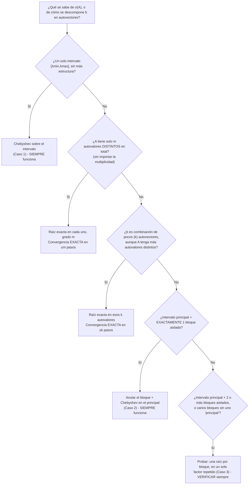

# Cómo elegir el polinomio $p$ para las cotas de GC

> [!idea]
> Todas las cotas de [[Cotas de error del gradiente conjugado|error del GC]] son, en el fondo, el mismo truco: **inventar** un polinomio $p$ de grado $\leq k$ con $p(0)=1$ que sea chico en todo el espectro de $A$, y usarlo como testigo en $\|x_k-x_*\|_A\leq\big(\max_{\lambda\in\sigma(A)}|p(\lambda)|\big)\|x_0-x_*\|_A$. GC *en sí mismo* no elige ningún polinomio - el [[Teorema 5.13]] garantiza que GC hace **al menos tan bien** como el mejor polinomio posible. El trabajo de esta nota es: dado lo que se sabe de $\sigma(A)$, ¿qué $p$ conviene *proponer* para obtener una cota lo más ajustada posible?

## Punto de partida

Por el [[Corolario 5.14]]:
$$
\|x_k-x_*\|_A \leq \Big(\max_{\lambda\in\sigma(A)}|p(\lambda)|\Big)\|x_0-x_*\|_A, \qquad \text{para \textbf{cualquier} } p\in\overline{\mathcal P}_k:=\{p \text{ polinomio},\ \deg p\leq k,\ p(0)=1\}.
$$
Como la desigualdad vale para **cualquier** $p$ que uno proponga, conviene elegir el que dé la cota más chica - esa es toda la libertad (y toda la dificultad) del problema. Dos restricciones, nada más:
- $p(0)=1$ (siempre, viene de cómo se construye $p$ a partir de la iteración - ver [[Teorema 5.13]]).
- $\deg p\leq k$, con $k$ la iteración en la que se quiere la cota (**más iteraciones = polinomio de mayor grado = más libertad para hacerlo chico**).

## La idea en una frase

**Un polinomio de grado $k$ tiene $k$ raíces para "gastar". Gastar una raíz cerca de un autovalor lo anula casi por completo ahí - el resto del grado se reparte para achicar el polinomio en todo lo demás.** Toda la técnica de esta nota es alguna variante de esta idea.

## Caso 1: el espectro vive en un intervalo $[\lambda_{\min},\lambda_{\max}]$ (Chebyshev)

Esta es la construcción que hace el [[Teorema 5.19]], y es la más abstracta de todas - vale la pena pararse a entender **qué** se está construyendo y **por qué**, no solo mirar la fórmula final.

**El problema a resolver.** Entre todos los polinomios $p$ de grado $\leq k$ con $p(0)=1$, se busca el que tenga $\max_{z\in[\lambda_{\min},\lambda_{\max}]}|p(z)|$ más chico posible. Dos restricciones tironeando en direcciones opuestas: $p(0)=1$ "ancla" al polinomio en un punto (típicamente lejos del intervalo, porque $0\notin[\lambda_{\min},\lambda_{\max}]$ si $A$ es sdp), y al mismo tiempo se le pide ser chico en *todo* el intervalo.

Para no perderse, todo este caso usa **un solo ejemplo numérico de punta a punta**: $\lambda_{\min}=1$, $\lambda_{\max}=9$ (es decir $\kappa=9$), y se quiere un polinomio de grado $k=2$. Cada paso se explica en general y **enseguida** con estos números concretos - si en algún punto los símbolos marean, ir directo al número.

> [!pendiente]
> Ojo con un posible lío de notación: de acá en adelante aparece una variable auxiliar que **no tiene nada que ver** con los $x_k$ (los iterados de GC) del resto del capítulo. Para evitar la confusión, a esa variable auxiliar la llamamos $t$, no $x$.

**Paso 1 - por qué Chebyshev, y qué son.** Los polinomios de Chebyshev se definen por la recursión $T_0(t)=1$, $T_1(t)=t$, $T_k(t)=2t\,T_{k-1}(t)-T_{k-2}(t)$. No es una fórmula para memorizar: es una receta, se "da cuerda" reemplazando $k$. Para $k=2$ (el que usa el ejemplo), con $T_0$ y $T_1$ ya dados arriba:
$$
T_2(t) = 2t\cdot T_1(t) - T_0(t) = 2t\cdot t - 1 = 2t^2-1.
$$
(Si hiciera falta $T_3$, se repite: $T_3(t)=2t\cdot T_2(t)-T_1(t)=2t(2t^2-1)-t=4t^3-3t$, y así siguiendo - cada uno se arma con los dos anteriores.)

¿De dónde sale que *esta* receta en particular sea la buena? No es arbitraria: se puede probar que $T_k(t)=\cos(k\arccos t)$ para $t\in[-1,1]$, y la recursión de arriba es, ni más ni menos, la identidad trigonométrica del coseno de un múltiplo de ángulo "desenrollada" en potencias de $t$. Para $k=2$ se ve directo: con $t=\cos\theta$, $T_2(t)=\cos(2\theta)=2\cos^2\theta-1=2t^2-1$ (la fórmula del coseno del ángulo doble) - coincide exactamente con lo que dio la recursión. Esa representación con coseno es la que garantiza $|T_k(t)|\leq1$ en $[-1,1]$ **siempre** (porque $|\cos(\text{cualquier cosa})|\leq1$), y que $T_k$ toca $\pm1$ varias veces en vez de solo en los bordes (*equioscilación*, porque el coseno vale $\pm1$ repetidamente). Esa es la razón - no demostrada acá en profundidad - de que Chebyshev resulte ser la elección óptima: "reparte" el error parejo en vez de desperdiciarlo en una punta, a diferencia de, por ejemplo, $(1-t)^k$, que es chico cerca de $t=1$ pero se dispara cerca de $t=-1$.

El problema: esta propiedad linda ($|T_k(t)|\leq1$) es **solo en $[-1,1]$**. Nuestro intervalo de interés es $[\lambda_{\min},\lambda_{\max}]=[1,9]$, que no es $[-1,1]$. Los pasos 2 y 3 son, nada más, el trámite de **adaptar** $T_k$ a nuestro intervalo sin perder esa propiedad.

**Paso 2 - "estirar" $[\lambda_{\min},\lambda_{\max}]$ hasta que quede $[-1,1]$.** Se busca una fórmula $t(z)$ que mande $\lambda_{\min}\mapsto-1$ y $\lambda_{\max}\mapsto1$ (los extremos de nuestro intervalo, a los extremos del intervalo donde Chebyshev funciona bien). Es la misma cuenta de siempre para reescalar cualquier intervalo $[a,b]$ a $[-1,1]$: restar el punto medio y dividir por el medio-ancho.
$$
t(z) := \frac{z-\frac{\lambda_{\max}+\lambda_{\min}}2}{\frac{\lambda_{\max}-\lambda_{\min}}2}.
$$
**Con los números del ejemplo** ($\lambda_{\min}=1$, $\lambda_{\max}=9$: punto medio $5$, medio-ancho $4$): $t(z)=\dfrac{z-5}4$. Chequeo: $t(1)=\frac{1-5}4=-1$ ✓, $t(9)=\frac{9-5}4=1$ ✓ - exactamente lo que se pedía.

![[gc-poly-cambio-de-variable.png]]

(El dibujo es literalmente eso: el eje $z$ de arriba, con $[1,9]$ marcado, "se encoge" al eje $t$ de abajo, donde ese mismo intervalo pasa a ser $[-1,1]$. El punto $z=0$ - que nos interesa porque ahí se exige $p(0)=1$ - va a parar a $t(0)=\frac{0-5}4=-1.25$: **afuera** de $[-1,1]$, porque $0$ también estaba afuera de $[1,9]$. Esto no es un detalle menor, es la clave de todo lo que sigue.)

Con este cambio de variable, el polinomio $T_2(t(z))$ ya hereda la propiedad buena de Chebyshev, pero trasladada a nuestro intervalo: $|T_2(t(z))|\leq1$ para todo $z\in[1,9]$ (porque ahí $t(z)\in[-1,1]$). **Pero** todavía no es el $p$ que buscamos, porque no cumple $p(0)=1$: $T_2(t(0))=T_2(-1.25)=2(-1.25)^2-1=2.125$, que no es $1$.

**Paso 3 - arreglar lo único que falta: dividir.** $T_2(t(0))=2.125$ es solo un número fijo, ni grande ni raro - el **único** paso que falta es dividir todo por ese número, para que al evaluar en $z=0$ dé $1$ (cualquier número dividido por sí mismo da $1$, no hay nada más profundo en este paso):
$$
p_2(z) := \frac{T_2(t(z))}{T_2(t(0))} = \frac{T_2(t(z))}{2.125}.
$$
Ahora sí, $p_2(0)=\dfrac{T_2(t(0))}{T_2(t(0))}=1$ ✓ (por construcción, automático). Y como dividir por $2.125$ (un número $>1$) **achica** las cosas, en el intervalo sigue siendo chico - de hecho, como ahí $|T_2(t(z))|\leq1$:
$$
\max_{z\in[1,9]}|p_2(z)| \leq \frac1{2.125} \approx 0.4706.
$$
Verificado con números (`T2(t(z)) = 2*((z-5)/4)^2 - 1`, `p(z) = T2(t(z))/2.125`): `p(0)=1`, `p(1)=p(9)≈0.4706`, `p(5)≈-0.4706`. Los extremos del intervalo llegan **exactamente** a la cota $1/2.125$ (ni más ni menos) - confirma que no es una cota floja, se alcanza de verdad, consistente con la equioscilación del Paso 1.

**Por qué esto da la cota $O(\sqrt\kappa)$ en general** (sin hacer la cuenta completa, que está en el [[Teorema 5.19]]): todo quedó reducido a "¿qué tan grande es $T_k(t(0))$?" - cuanto más grande, mejor (más chica la cota $1/|T_k(t(0))|$). Y $T_k$ crece **rápido** apenas uno se sale de $[-1,1]$ (a diferencia de adentro, donde nunca pasa de $1$) - cuanto peor condicionada esté $A$ (⟹ $\lambda_{\min}$ chico comparado con $\lambda_{\max}$ ⟹ $z=0$ queda relativamente "más lejos" de $[\lambda_{\min},\lambda_{\max}]$ en la escala $t$), más lejos cae $t(0)$ de $[-1,1]$, más grande $T_k(t(0))$. Calcular $T_k(t(0))$ explícitamente (el Teorema 5.19 lo hace con una identidad que convierte a $T_k$ fuera de $[-1,1]$ en una potencia $k$-ésima) es de donde sale el $\sqrt\kappa$ de la fórmula final.

![[gc-poly-caso1-chebyshev.png]]

($\lambda_{\min}=1$, $\lambda_{\max}=100$, $\kappa=100$, grado $k=6$.) Notar: el polinomio cae en picada desde $p(0)=1$ hasta entrar en la banda de oscilación apenas pasado $z=1$, y esa banda (acá, $\pm0.55$ aprox.) es la **misma cota** que predice [[Teorema 5.19|la fórmula]] $2\big(\frac{\sqrt\kappa-1}{\sqrt\kappa+1}\big)^k$. Cuantas más iteraciones, más angosta la banda (más oscilaciones, cada una más chica).

**Cuándo usarlo:** es el caso por defecto, cuando lo único que se conoce es $\kappa_2(A)$. Da la cota $O(\sqrt\kappa)$ de siempre.

## Caso 2: un bloque de autovalores aislado

Si además de un intervalo principal $[a,b]$ hay un **bloque chico y lejano** $[c,d]$ (ej. unos pocos autovalores mucho más grandes que el resto), no hace falta pagar con todo el grado por ese bloque: alcanza con **una raíz** (o un par, si hace falta más margen) ubicada *dentro* o *cerca* del bloque aislado, elevada a una potencia moderada - eso lo anula casi del todo sin gastar mucho grado, y el resto del grado se reparte en Chebyshev sobre el intervalo principal, que es mucho más angosto que $[a,d]$ junto. Ver la construcción completa (y por qué funciona) en [[5.8 - Cota pesimista autovalor aislado|Problema 5.8]].

![[gc-poly-caso2-aislado.png]]

($\sigma(A)\subset[1,1.5]\cup[399,400]$, $p_{15}(z)=\big(\frac{1.25-z}{1.25}\big)^5\big(\frac{400-z}{400}\big)^{10}$, grado $15$.) El panel izquierdo muestra que ya casi no hay nada que hacer en $[1,1.5]$ - el polinomio decae a (prácticamente) cero *antes* de llegar ahí. El panel derecho confirma que el bloque aislado queda anulado hasta el orden $10^{-7}$ o mejor. Comparado con usar Chebyshev sobre **todo** $[1,400]$ (que daría $\kappa\approx400$, mucho peor), esta cota específica gana **órdenes de magnitud** con el mismo $k$ - ver la comparación numérica completa en el Problema 5.8.

**Cuándo usarlo:** cuando $\kappa_2(A)$ está "inflado" por pocos autovalores atípicos, lejos del resto del espectro.

## Caso 3: varios bloques aislados

La misma idea se generaliza a $m$ bloques angostos y separados: un **único factor de grado $m$** con una raíz por bloque (en vez de $m$ factores independientes elevados a potencias distintas - eso puede desbalancearse, ver la nota abajo), repetido $k$ veces hasta grado $mk$. Desarrollado en detalle en [[Parcial Modelo - Problema 3]] (bonus de un examen real, con tres bloques).

![[gc-poly-caso3-tres-bloques.png]]

($\sigma(A)\subset[1,2]\cup[2000,2001]\cup[4999,5000]$, $p_{15}(z)=\Big(\frac{(1.5-z)(2000.5-z)(4999.5-z)}{1.5\cdot2000.5\cdot4999.5}\Big)^5$, grado $15$.) Cada panel es un zoom a uno de los tres bloques: el polinomio cae a (casi) cero en los tres, con el mismo polinomio.

**¿Y si el presupuesto de grado no es múltiplo de $m$?** $q(z)^k$ (con $q$ de grado $m$) solo existe en grados $m,2m,3m,\dots$ - para un $k$ total que no es múltiplo de $m$ (ej. grado $14$ con $m=3$ bloques) hay que decidir qué hacer con el resto. Verificado con el ejemplo de arriba, tres opciones para llegar a grado $14$ (en vez de truncar a $q^4$, grado $12$, que da $\max|p|=0.062$):

> [!comparacion]
> | Qué hacer con los 2 grados sobrantes | $\max|p|$ (grado 14) |
> |---|---|
> | Reforzar el bloque que **ya era el peor** (acá, el más lejano: $\times\big(\frac{c_3-z}{c_3}\big)^2$) | $0.012$ (¡mejor que $q^5$, grado 15, que da $0.031$!) |
> | Reforzar un bloque **distinto** (ej. el más cercano) | $692{,}317$ (explota) |
> | Agregar un Chebyshev extra sobre el intervalo principal | $733{,}042$ (explota) |

**La regla:** el grado sobrante nunca se reparte "a cualquier lado" - se usa para reforzar **específicamente el bloque que domina el máximo** (acá, el bloque 3: mirando el desglose, con $q^5$ daba $\max\approx0.031$ en el bloque 3 contra $\approx0.004$ y $\approx0.0003$ en los otros dos - el 3 era, por lejos, el cuello de botella). Reforzar cualquier otro punto reproduce la misma trampa de desbalance de la nota de abajo: un factor pensado para un lugar se dispara al evaluarlo lejos de ahí.

> [!pendiente]
> **Por qué conviene un único factor con una raíz por bloque, repetido, y no factores independientes a potencias distintas.** La tentación es poner $\big(\frac{c_1-z}{c_1}\big)^{k_1}\big(\frac{c_2-z}{c_2}\big)^{k_2}\big(\frac{c_3-z}{c_3}\big)^{k_3}$ con $k_1,k_2,k_3$ elegidos "a mano" para cada bloque. El problema: el factor que anula el bloque **chico** (cerca de $0$) toma valores **enormes** al evaluarlo en los bloques lejanos (ej. $\frac{1.5-2000}{1.5}\approx-1333$), y si $k_1$ es grande ese valor elevado a la $k_1$ puede desbordar cualquier compensación razonable de los otros factores - se probó numéricamente en [[Parcial Modelo - Problema 3]] y el grado total necesario terminaba siendo **peor**, no mejor, que la cota genérica. La construcción con una raíz por bloque en un **solo** factor, repetida uniformemente, evita el desbalance porque los tres factores "pesan" parecido en todas partes.

**Cuándo usarlo:** varios grupos de autovalores separados entre sí, ninguno claramente "el principal".

## Caso límite: pocos autovalores distintos (convergencia exacta)

Si $A$ tiene exactamente $m$ autovalores **distintos** (sin importar la multiplicidad, ni cuántos son en total: $A$ puede ser $10^5\times10^5$ con solo $3$ valores distintos), se puede poner una raíz **exacta** en cada uno:
$$
p(z) = \prod_{i=1}^m\Big(1-\frac z{\lambda_i}\Big), \qquad p(\lambda_i)=0 \ \ \forall i.
$$
Esto da $\max_{\lambda\in\sigma(A)}|p(\lambda)|=0$ **exactamente** - la cota del [[Corolario 5.14]] da $\|x_m-x_*\|_A\leq0$, es decir, GC converge **exacto** en a lo sumo $m$ pasos. Es el [[Teorema 5.21]] (y su variante con autovectores en vez de autovalores, el [[Teorema 5.22]], cuando ni siquiera hace falta que $A$ tenga pocos autovalores - alcanza con que $b$ "viva" en pocos de ellos).

![[gc-poly-caso4-raices-exactas.png]]

($\sigma(A)=\{1,5,10\}$, $p(z)=\big(1-\frac z1\big)\big(1-\frac z5\big)\big(1-\frac z{10}\big)$, grado $3$.) A diferencia de los casos anteriores, acá no hay "cota" ni aproximación: el polinomio toca cero **exactamente** en cada autovalor, sin importar nada de lo que pase entre medio.

**Cuándo usarlo:** no es tanto una elección como una observación - si el problema tiene pocos autovalores distintos (o $b$ tiene pocas componentes espectrales), conviene **reconocerlo**, porque cambia la respuesta de "cuántas iteraciones hacen falta" de una estimación a un número exacto, mucho más chico. Ver [[Parcial Modelo - Problema 4]](g) para un ejemplo de cómo detectar esto sin que sea obvio a primera vista (ahí, $b$ resulta ser un autovector puro disfrazado de función $\text{sen}(\pi x)$).

## Receta: qué hacer según lo que se sabe de $\sigma(A)$

Las ramas **$R_1$, $R_2$, $R_4$, $R_5$ son recetas que siempre funcionan** (son las ya desarrolladas en los casos de arriba, con demostración o con una cota que se puede hacer tan chica como se quiera aumentando el grado). La rama **$R_3$ no es una garantía**, es una *receta para probar primero* - acá va la explicación de por qué, con un contraejemplo real.

> [!pendiente]
> **Por qué "varios bloques aislados" no tiene una receta garantizada (a diferencia de los otros casos).** La tentación es pensar que la construcción de [[Parcial Modelo - Problema 3]] (una raíz por bloque, en un solo factor, repetida $k$ veces) funciona siempre que los bloques estén bien separados. **No es así** - depende de la posición relativa exacta de los bloques, de una forma que no es fácil de predecir sin probar. Tres corridas numéricas con la misma estructura (intervalo $[1,2]$ + dos bloques aislados) y resultados muy distintos:
> - Centros en $1.5,\ 2000.5,\ 4999.5$ (el caso real del Problema 3): **funciona bien**, los tres bloques bajan con $k$ (a $k=17$, los tres están por debajo de $10^{-5}$).
> - Centros en $1.5,\ 500.5,\ 2000.5$: el bloque más lejano ($[2000,2001]$) se queda **pegado cerca de $1$** sin bajar, para cualquier $k$ probado - la construcción simplemente no sirve acá, no es que haga falta más grado.
> - Centros en $1.5,\ 150,\ 15000$ (separación geométrica, factor $100$ entre cada uno): el bloque más lejano **explota** (valores de $10^9$ a $10^{27}$ en vez de achicarse).
>
> La razón de fondo: al evaluar el polinomio en un bloque lejano, los factores "pensados" para los *otros* bloques no necesariamente se quedan chicos ahí - pueden crecer sin control, y si ese crecimiento le gana al factor que sí apunta a ese bloque, el resultado total crece en vez de achicarse. No hay una regla simple de cuándo pasa esto. **Conclusión práctica:** si aparece este caso, proponer la construcción, pero graficar o calcular $\max|p|$ en **cada** bloque por separado (no solo confiar en la fórmula) antes de reportar una cota - exactamente la misma disciplina de "verificar, no asumir" que se usó para corregir código en otras partes de este vault.

## Ver también
- [[Cotas de error del gradiente conjugado]]
- [[Teorema 5.13]] · [[Corolario 5.14]] · [[Teorema 5.19]] · [[Teorema 5.21]] · [[Teorema 5.22]]
- [[5.8 - Cota pesimista autovalor aislado|Problema 5.8]]
- [[Parcial Modelo - Problema 3]] · [[Parcial Modelo - Problema 4]]
