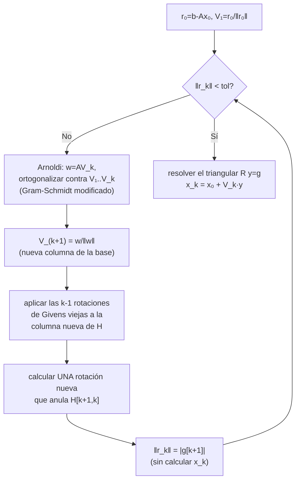

# [[GMRes - definicion y propiedad de minimizacion|GMRes]]: implementación con Arnoldi y [[Rotaciones de Givens|rotaciones de Givens]]

> [!idea]
> Tres ideas encadenadas para llegar a una implementación de costo $O(nk)$ por iteración: (1) proceso de Arnoldi ([[Ortogonalizacion de Gram-Schmidt|Gram-Schmidt]] sobre el espacio de Krylov) reduce el problema de [[Minimos cuadrados y ecuaciones normales|mínimos cuadrados]] de $n×k$ a $(k+1)×k$; (2) Gram-Schmidt **modificado** evita perder ortogonalidad por redondeo; (3) rotaciones de Givens actualizan la factorización QR de la Hessenberg **incrementalmente**, una rotación nueva por iteración, en vez de rehacer todo desde cero.

## Proceso de Arnoldi

Ortonormaliza $\mathcal K_k$ dando $V_k$ (columnas ortonormales) y $H_k$ Hessenberg superior $(k+1)\times k$, con $AV_k=V_{k+1}H_k$.

```julia
function arnoldi_step!(A, V, H, k)   # agrega la columna k+1 - muta V y H in-place (por eso el !)
    w = A*V[:,k]
    for j in 1:k
        H[j,k] = w'V[:,j]
        w -= H[j,k]*V[:,j]          # clásico; modificado: restar apenas se calcula cada H[j,k]
    end
    H[k+1,k] = norm(w)
    V[:,k+1] = w / H[k+1,k]
end
```
*(Lleva `!` porque muta `V` y `H` a propósito - la idea es llamarla repetidas veces para ir agrandando la base, no devolver una copia nueva en cada paso.)*

**Lema 5.43 (breakdown = buena noticia):** si el proceso se detiene en el paso $i$ ($z_{i+1}=0$), entonces $x=A^{-1}b\in x_0+\mathcal K_i$ **ya está** en el espacio actual - se encontró la solución exacta ("*lucky breakdown*"). Demostración completa: [[Lema 5.43]].

**Gram-Schmidt modificado:** restar cada proyección usando el vector ya corregido (no el original), en vez de todas con el original a la vez. Matemáticamente idéntico en aritmética exacta, pero mucho más estable en punto flotante - mismo fenómeno que en [[Ortogonalizacion de Gram-Schmidt]] (Capítulo 3).

## El ciclo del algoritmo



A diferencia de GC, acá **sí** hace falta guardar toda la base $V_1,\dots,V_k$ (columna nueva en cada paso) - por eso la memoria crece con $k$. Lo que Givens evita es **recalcular** la QR de $H_k$ entera en cada paso: solo agrega una rotación.

## El problema chico

Con $\beta=\|r_0\|_2$, $V_{k+1}$ ortonormal: $\|r_k\|_2=\|\beta e_1-H_ky_k\|_2$, un mínimos cuadrados de $(k+1)\times k$ (no de $n\times k$) - el residuo se conoce **sin calcular $x_k$**.

## Rotaciones de Givens: actualizar en vez de rehacer

$H_{k+1}$ contiene a $H_k$ más una columna y una fila de ceros. Si $H_k=Q_kR_k$, aplicar las rotaciones viejas $Q_k$ a la columna nueva deja casi todo triangularizado - falta anular **un único** elemento, con **una** rotación nueva $G_{k+1}$ (ver [[Rotaciones de Givens]], Capítulo 3). Así, cada iteración cuesta $O(k)$ en vez de rehacer una QR completa ($O(k^2)$).

## Algoritmo final (versión con Gram-Schmidt modificado y Givens)

```julia
function gmres(A, b, x0; tol=1e-8, kmax=length(b))
    Av(v) = A isa Function ? A(v) : A*v    # A puede ser matriz o function handle
    r0 = b - Av(x0)
    β = ρ = norm(r0)
    V = zeros(length(b), kmax+1)
    V[:,1] = r0/ρ
    H = zeros(kmax+1, kmax)
    g = zeros(kmax+1)
    g[1] = β
    c = zeros(kmax)
    s = zeros(kmax)
    k = 0
    while ρ > tol*norm(b) && k < kmax
        k += 1
        w = Av(V[:,k])
        for j in 1:k                       # Arnoldi, Gram-Schmidt modificado
            H[j,k] = w'V[:,j]
            w -= H[j,k]*V[:,j]
        end
        H[k+1,k] = norm(w)
        V[:,k+1] = w/H[k+1,k]
        for j in 1:k-1                      # aplicar rotaciones viejas a la columna nueva
            H[j:j+1,k] = [c[j] -s[j]; s[j] c[j]] * H[j:j+1,k]
        end
        ν = hypot(H[k,k], H[k+1,k])          # rotación nueva, anula H[k+1,k]
        c[k] = H[k,k]/ν
        s[k] = -H[k+1,k]/ν
        H[k,k] = ν
        H[k+1,k] = 0
        g[k:k+1] = [c[k] -s[k]; s[k] c[k]] * g[k:k+1]
        ρ = abs(g[k+1])                      # = ‖b-Ax_k‖₂, sin calcular x_k
    end
    y = UpperTriangular(H[1:k,1:k]) \ g[1:k]
    return x0 + V[:,1:k]*y, k
end
```

Igual que `gradconj` ([[Implementacion del gradiente conjugado]]), `A` puede ser una matriz o un *function handle* ($ξ\to A\xi$) - matrix-free, útil para precondicionamiento ([[GMRes - precondicionamiento]]) o cuando $A$ ni siquiera se construye explícitamente (ver [[5.6 - Funcion matvec tridiagonal|Problema 5.6]]).

## Restart: `GMRes(m)`

Sin recurrencia corta, la memoria crece $O(nk)$ y el costo acumulado $O(nk^2)$. `GMRes(m)` reinicia cada $m$ iteraciones ($x_0\leftarrow x_m$, descartando la base). **No hay teoría de convergencia** para `GMRes(m)` en general - puede estancarse -, pero con buen precondicionamiento el restart casi no cuesta nada: el precondicionador es lo que hace viable usar $m$ chico.

## Ver también
- [[GMRes - definicion y propiedad de minimizacion]]
- [[Rotaciones de Givens]] (Capítulo 3)
- [[Tablas Comparativas - GC vs GMRes]]
