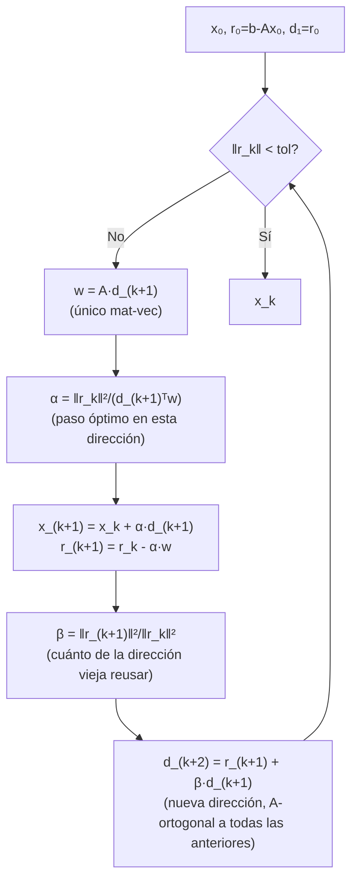

# Implementación del [[Gradiente conjugado - definicion y propiedades|gradiente conjugado]]

> [!idea]
> La implementación final es sorprendentemente barata: **recurrencia de dos términos** (cada dirección nueva depende solo de la anterior, no hay que guardar toda la base de Krylov - a diferencia de [[GMRes - definicion y propiedad de minimizacion|GMRes]]). 1 producto matriz-vector, 2 productos escalares, 3 $axpy$ por iteración, 4 vectores en memoria.

## Las piezas (Lemas 5.23–5.27)

- **Dirección de búsqueda $d_{k+1}$:** el único vector en $\mathcal K_{k+1}$ que es $A$-ortogonal a $\mathcal K_k$ (existe y es único por dimensión: $\dim\mathcal K_{k+1}-\dim\mathcal K_k=1$). Demostración completa: [[Lema 5.23]].
- **Paso:** $x_{k+1}=x_k+\alpha_{k+1}d_{k+1}$, $\alpha_{k+1}=\dfrac{d_{k+1}^Tr_k}{d_{k+1}^TAd_{k+1}}$. Demostración completa: [[Corolario 5.24]].
- **Las direcciones también generan Krylov:** $\{d_1,\dots,d_k\}$ es $A$-ortogonal y $\text{span}\{d_1,\dots,d_k\}=\mathcal K_k$ - de ahí el nombre "conjugadas" ($A$-ortogonales). Demostración completa (inducción): [[Lema 5.25]].
- **Recurrencia de dos términos (el resultado clave):** $d_{k+1}=r_k+\beta_{k+1}d_k$, con $\beta_{k+1}=-\dfrac{r_k^TAd_k}{d_k^TAd_k}$. Demostración completa: [[Teorema 5.26]].
  **"El milagro"**: a priori $d_{k+1}=r_k+\sum_{i\leq k}\gamma_id_i$ tendría $k$ coeficientes a determinar; se demuestra que $\gamma_j=0$ para $j<k$ (porque $Ad_j\in\mathcal K_{j+1}\subset\mathcal K_k$ y $r_k\perp\mathcal K_k$), así que solo sobrevive el término con $d_k$.
- **Fórmulas finales, solo con residuos:**
$$
\beta_{k+1} = \frac{r_k^Tr_k}{r_{k-1}^Tr_{k-1}}, \qquad \alpha_{k+1}=\frac{\|r_k\|_2^2}{d_{k+1}^TAd_{k+1}}.
$$
  Demostración completa: [[Lema 5.27]].

## El ciclo del algoritmo



Nada de esto guarda la base de Krylov completa (a diferencia de GMRes): $\beta$ "resume" toda la información de las direcciones anteriores en un solo número - esa es la recurrencia de dos términos.

## Algoritmo final

```julia
"""
    gradconj(A, b, x0; tol=1e-8, max_iter=1000)

A puede ser matriz o function handle (acción ξ → Aξ).
"""
function gradconj(A, b, x0; tol=1e-8, max_iter=1000)
    Av(v) = A isa Function ? A(v) : A*v
    x = copy(x0)
    r = b - Av(x)
    ρ = r'r
    d = copy(r)
    ρold = 0.0
    iter = 0
    while sqrt(ρ) > tol && iter < max_iter
        if iter > 0
            β = ρ/ρold
            d = r + β*d
        end
        w = Av(d)
        α = ρ/(d'w)
        x += α*d
        r -= α*w
        ρold = ρ
        ρ = r'r
        iter += 1
    end
    return x, iter
end
```

**Costo por iteración:** 1 mat-vec ($Ad$), 2 productos escalares ($d^Tw$, $r^Tr$), 3 $axpy$ ($d=r+βd$, $x=x+αd$, $r=r-αw$). 4 vectores en memoria: $x,r,d,w$.

> [!idea]
> No hace falta guardar una base del espacio de Krylov ($d_1,\dots,d_k,\dots$) - esa es la gran ventaja de que $A$ sea sdp. Para matrices no sdp (GMRes), esto deja de ser cierto: hay que guardar **toda** la base, y el costo por iteración crece con $k$ (ver [[Tablas Comparativas - GC vs GMRes]]).

## Criterio de parada

$$
\|r_k\|_2<\text{tol}\cdot\|b\|_2 \implies \frac{\|x_k-x_*\|_2}{\|x_*\|_2}\leq\kappa_2(A)\cdot\text{tol}.
$$

## Ver también
- [[Gradiente conjugado - definicion y propiedades]]
- [[Precondicionamiento y GCP]]
