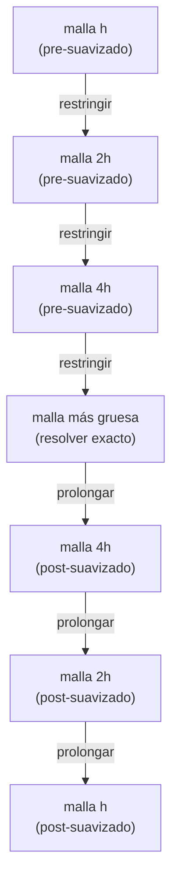

# Multigrid en 1D: transferencia, ciclo en V, y como precondicionador

> [!idea]
> Encadenando suavizado + corrección en malla gruesa **recursivamente** (bajando de malla en malla hasta un problema trivial) se obtiene el *ciclo en V*: costo $O(n)$ por ciclo, y - el resultado fuerte del capítulo - factor de reducción del error $ρ<1$ **independiente de $h$ y de la cantidad de niveles** (Teorema 5.34). Usado como precondicionador del GC, el número de condición del sistema precondicionado queda **acotado independientemente de $h$**: el único precondicionador del curso que logra esto.

## Operadores de transferencia (eq. 5.23: relación variacional)

- **Prolongación** $I_{2h}^h:\mathbb{R}^{n_c}\to\mathbb{R}^n$ (interpolación lineal, malla gruesa → fina):
$$
(I_{2h}^hv)_{2k} = v_k, \qquad (I_{2h}^hv)_{2j+1} = \tfrac12(v_j+v_{j+1}), \qquad v_0:=0,\ v_{n_c+1}:=0.
$$
- **Restricción** $I_h^{2h}:\mathbb{R}^n\to\mathbb{R}^{n_c}$ (ponderación completa, *full weighting*, malla fina → gruesa):
$$
(I_h^{2h}w)_j = \tfrac14(w_{2j-1}+2w_{2j}+w_{2j+1}).
$$

## Teorema (eq. 5.23): relación variacional entre restricción y prolongación

$$
I_h^{2h} = \frac12\big(I_{2h}^h\big)^T.
$$
Garantiza que el operador de dos mallas $I_h^{2h}A_hI_{2h}^h$ sea simétrico - esencial para que el ciclo en V sea sdp y se pueda usar como precondicionador del GC.

Demostración completa (a partir de las fórmulas explícitas de $P:=I_{2h}^h$ y su transpuesta): [[Teorema de la relacion variacional (eq. 5.23)]].

Verificación numérica (reconstruyendo las matrices y comparando) en [[5.12 - Multigrid como metodo iterativo|Problema 5.12]](b).

## El ciclo en V (recursivo)

1. **Pre-suavizado:** $ν₁$ barridos de [[Metodo de Jacobi|Jacobi]] amortiguado.
2. **Residuo:** $r=f-A_hu$.
3. **Restricción:** $r_{2h}=I_h^{2h}r$.
4. **Corrección gruesa:** resolver $A_{2h}e_{2h}=r_{2h}$ - **recursivamente** (mismo esquema, mitad de incógnitas), hasta un nivel tan chico que se resuelve exacto. ($A_{2h}$ acá es la misma familia tridiagonal, discretizada de nuevo con paso $2h$ - coincide exactamente con el *operador de Galerkin* $I_h^{2h}A_hI_{2h}^h$, demostrado en [[Teorema del operador de Galerkin A2h]].)
5. **Prolongación y corrección:** $u\leftarrow u+I_{2h}^he_{2h}$.
6. **Post-suavizado:** $ν₂$ barridos de Jacobi amortiguado.

```julia
function jacobiamortiguado(u, f, h, nu)
    u = copy(u)   # no muta el argumento de entrada (sin !, no debe mutar)
    n = length(u)
    ω = 2/3
    for _ in 1:nu
        Au = (2u .- [u[2:n];0] .- [0;u[1:n-1]]) / h^2
        u .+= ω * (h^2/2) .* (f .- Au)
    end
    return u
end

function restringir(r)
    n = length(r)
    nc = (n-1)÷2
    return [(r[2j-1] + 2r[2j] + r[2j+1])/4 for j in 1:nc]
end

function prolongar(vc)
    nc = length(vc)
    n = 2nc+1
    vext = [0; vc; 0]
    v = zeros(n)
    v[2:2:n-1] = vc
    v[1:2:n] = [(vext[j+1]+vext[j+2])/2 for j in 0:nc]
    return v
end

function vciclo(u, f, h, nu1, nu2)
    n = length(u)
    n == 1 && return f * h^2 / 2        # malla más gruesa: A_h es escalar 2/h²
    u = jacobiamortiguado(u, f, h, nu1)         # (1) pre-suavizado
    Au = (2u .- [u[2:n];0] .- [0;u[1:n-1]]) / h^2
    r = f - Au                                   # (2) residuo
    rc = restringir(r)                           # (3) restricción
    ec = vciclo(zeros(length(rc)), rc, 2h, nu1, nu2)   # (4) corrección (recursiva)
    u += prolongar(ec)                           # (5) prolongación y corrección
    u = jacobiamortiguado(u, f, h, nu2)          # (6) post-suavizado
    return u
end
```

**Costo:** $cn(1+\frac12+\frac14+\cdots)\leq2cn=O(n)$ - lineal en el número de incógnitas.

## El ciclo en V, visualmente



La "V" es literal: se baja de malla en malla (suavizando y restringiendo el residuo), se resuelve exacto en el fondo (barato, pocas incógnitas), y se vuelve a subir (prolongando la corrección y suavizando de nuevo). Cada nivel cuesta la mitad de incógnitas que el anterior, por eso el costo total es $O(n)$ y no $O(n\cdot\text{niveles})$.

## Por qué funciona: suavizado + cambio de escala, combinados


## Teorema 5.34 (convergencia del ciclo en V)

Con Jacobi amortiguado ($ω=2/3$), $ν$ barridos de pre/post-suavizado, existe $ρ<1$, **independiente de $h$ y de la cantidad de niveles**, tal que
$$
\|Ev\|_{A_h}\leq\rho\|v\|_{A_h}, \qquad \forall v, \qquad E:=I-MA_h \ \text{(matriz de iteración del ciclo en V)}. \tag{5.25}
$$
$ρ$ se puede hacer tan chico como se quiera aumentando $ν$.

> [!pendiente]
> La demostración de este teorema **excede los alcances del curso** (así lo dice explícitamente el apunte) - usa herramientas de la teoría general de multigrid (análisis de dos mallas, estimaciones de aproximación y suavizado) que no se desarrollan acá. Lo que **sí** hay que poder reproducir es la cadena de deducciones que sigue, tomando este teorema como dato: cómo pasar de (5.25) a que multigrid es un buen precondicionador.

## De la convergencia del ciclo en V a un precondicionador óptimo

**Paso 1 (multigrid es un método estacionario).** Un ciclo en V con datos $(u,f)$ se puede escribir $u\mapsto u+M(f-A_hu)$ para cierta matriz $M$. Restando $u_*=u_*+M(f-A_hu_*)$ de la iteración, el error nuevo es $E=I-MA_h$ por el error viejo - exactamente un método estacionario del Capítulo 4, con matriz de iteración $E$. $E$ tiene autovalores reales en $[-\rho,\rho]$, y por lo tanto $\sigma(MA_h)\subset[1-\rho,1+\rho]$. Demostración completa: [[Multigrid - autovalores de E en -rho,rho|Multigrid, Paso 1]].

**Paso 2 ($M$ es un buen precondicionador: de $\sigma(MA_h)$ a $\kappa_2(SA_hS)$).** Sea $S:=M^{1/2}$. Entonces $\kappa_2(SA_hS)\leq\dfrac{1+\rho}{1-\rho}$, independiente de $h$. Demostración completa: [[Multigrid - cota kappa2(SAS) independiente de h|Multigrid, Paso 2]].

Con $ρ=0.1$ típico: $c_2/c_1\leq1.22$, factor de reducción $<0.05$ por iteración - unas 5 iteraciones para ganar 6 cifras, **cualquiera sea $n$**. Contra $O(n)$ iteraciones de GC sin precondicionar.

## Experimento numérico: la independencia de $h$, comprobada

Problema modelo 1D, $n=2^L-1$ para $L=5,\dots,12$ ($n$ de 31 a 4095), GC sin precondicionar vs. GC + multigrid (ciclo en V, $\nu=1$), hasta $\|r_k\|_2/\|b\|_2<10^{-10}$:

![[cap5-multigrid-independencia-h.png]]

GC necesita el **doble** de iteraciones cada vez que $n$ se duplica (16, 32, 64, ..., 2048 - lineal, consistente con $\kappa_2(A_h)=O(n^2)$ y la [[Cotas de error del gradiente conjugado|Observación 5.20]]). GC+multigrid se queda en 9-10 iteraciones en **todo** el rango, de $n=31$ a $n=4095$ - la confirmación numérica directa del Teorema 5.34.

```julia
# requiere Ah, jacobiamortiguado, restringir, prolongar, vciclo, gradconjp -
# ver [[Multigrid en 1D - problema modelo y suavizado]], [[Precondicionamiento y GCP]]

function gradconjp_resid_hist(A, b, precon, x0; tol=1e-10, max_iter=200)
    Mv(v) = precon isa Function ? precon(v) : precon*v
    x = copy(x0)
    r = b - A*x
    z = Mv(r)
    ρ = r'z
    d = copy(z)
    ρold = 0.0
    iter = 0
    while norm(r) > tol*norm(b) && iter < max_iter
        if iter > 0
            β = ρ/ρold
            d = z + β*d
        end
        w = A*d
        α = ρ/(d'w)
        x += α*d
        r -= α*w
        z = Mv(r)
        ρold = ρ
        ρ = r'z
        iter += 1
    end
    return x, iter
end

Ls = 5:12
ns = [2^L - 1 for L in Ls]
iters_gc = Int[]
iters_mg = Int[]
for n in ns
    h = 1/(n+1)
    A = Ah(n)
    xtrue = [xi*(1-xi) for xi in h:h:1-h]
    b = A * xtrue

    _, k_gc = gradconjp_resid_hist(A, b, v -> v, zeros(n); max_iter=3n)
    push!(iters_gc, k_gc)

    precon_mg(v) = vciclo(zeros(n), v, h, 1, 1)
    _, k_mg = gradconjp_resid_hist(A, b, precon_mg, zeros(n))
    push!(iters_mg, k_mg)
end

using CairoMakie
fig = Figure()
ax = Axis(fig[1, 1], xscale=log10, xlabel="n", ylabel="iteraciones hasta ‖r_k‖/‖b‖<1e-10",
          title="GC vs. GC+multigrid: iteraciones necesarias vs. n")
scatterlines!(ax, ns, iters_gc, label="GC (sin precondicionar)")
scatterlines!(ax, ns, iters_mg, label="GC + multigrid (ciclo en V, ν=1)")
axislegend(ax, position=:lt)
fig
```

## Ver también
- [[Multigrid en 1D - problema modelo y suavizado]]
- [[Precondicionamiento y GCP]]
- [[Precondicionadores genericos]]
- [[Tablas Comparativas - Precondicionadores]] - comparación con los genéricos, ventajas y desventajas de cada uno
