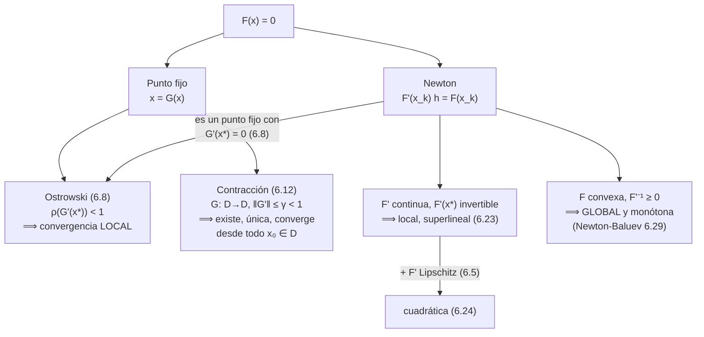

# Capítulo 6 - Sistemas de ecuaciones no lineales

> [!idea]
> Pregunta central: ¿cómo resolver $F(x)=0$ cuando $F$ no es lineal? Dos ideas. (1) **Punto fijo**: reescribir como $x=G(x)$ e iterar, la generalización directa de los métodos estacionarios del Capítulo 4, que converge si $G$ es una **contracción** (lineal, factor $\gamma$). (2) **Newton**: linealizar $F$ en cada paso y resolver un sistema **lineal** (Capítulos 2–5), que converge **cuadráticamente** cerca de la raíz pero solo localmente, salvo estructura extra (convexidad: Newton-Baluev).

## Teoría

- [[Sistemas no lineales - planteo y jacobiano]] (intro, Def. 6.3–6.4) - $F(x)=0$, matriz jacobiana.
- [[Iteracion de punto fijo y teorema de Ostrowski]] (6.1, Obs. 6.5 – Obs. 6.9) - $\rho(G'(x_*))<1$ ⟹ convergencia local.
- [[Contracciones y teorema de punto fijo]] (Def. 6.10 – Obs. 6.13) - contracción en un cerrado invariante ⟹ existencia, unicidad, convergencia global en $D$.
- [[Criterio de contraccion via la derivada]] (Def. 6.14 – Cor. 6.19) - $\|G'\|\leq\alpha<1$ en un convexo ⟹ contracción. **Receta para los ejercicios.**
- [[Metodo de Newton - definicion y buena definicion]] (6.2, Lemas 6.20–6.21, Cor. 6.22, Teo. 6.23) - convergencia local superlineal.
- [[Metodo de Newton - convergencia cuadratica]] (Teo. 6.24, Obs. 6.25) - $F'$ Lipschitz ⟹ orden 2; cómo medir el orden.
- [[Convergencia global de Newton - Newton-Baluev]] (6.2.1, Def. 6.27 – Obs. 6.30) - convexidad + $F'^{-1}\geq0$ ⟹ convergencia global y monótona.

## Problemas (6.1 a 6.18)

Ver [[Capitulo 6 - Problemas - Indice]].

## Teoremas y demostraciones

Ver [[Demostraciones - Capitulo 6]] (un archivo por resultado, en `Teoremas/`).

## Comparaciones

Ver [[Tablas Comparativas - Punto fijo vs Newton]].

## El mapa del capítulo

## Qué hipótesis decide qué (resumen para el parcial)

| Resultado | Hipótesis clave | Conclusión | Contraejemplo si falta |
|---|---|---|---|
| Ostrowski (6.8) | $\rho(G'(x_*))<1$ | atracción local | $\rho=1$: [[6.1 - Rho igual a 1 no decide\|6.1]] (puede o no) |
| Contracción (6.12) | $D$ cerrado, $G(D)\subset D$, $\gamma<1$ uniforme | existe, única, global en $D$ | $\gamma_C\to1$: [[6.3 - Contraccion en acotados\|6.3]] ($\sqrt{1+x^2}$, sin punto fijo) |
| Newton local (6.23) | $F'$ continua en $x_*$, $F'(x_*)$ invertible | superlineal | $F'(x_*)$ singular: [[6.14 - Newton para x al cuadrado\|6.14]] (lineal) |
| Newton cuadrático (6.24) | + $F'$ Lipschitz en $x_*$ | orden 2 | solo Hölder: [[6.15 - Newton para x mas x a la 1 mas alfa\|6.15]] (orden $1+\alpha$) |
| Newton-Baluev (6.29) | $F$ convexa, $F'^{-1}\geq0$ | global, monótona | sin convexidad: [[6.18 - Newton-Baluev sin convexidad\|6.18]] (diverge / 2-ciclo) |

## Conexión con el resto del curso

- **Capítulo 4:** el punto fijo con $G(x)=Mx+c$ *es* un método iterativo estacionario; Ostrowski y la [[Observacion 6.13|Observación 6.13]] generalizan $\rho(M)<1$. Ostrowski usa el [[Teorema 4.20]] (norma con $\|A\|<\rho(A)+\varepsilon$).
- **Capítulos 2, 5:** cada paso de Newton resuelve un sistema lineal con $F'(x_k)$: LU, Cholesky si es sdp, métodos iterativos si es grande y rala. El [[6.17 - Newton en problema discretizado|Problema 6.17]] tiene jacobiano tridiagonal.
- **Número de condición:** los lemas de perturbación 6.20–6.21 son la misma idea que [[Numero de condicion y error relativo]].
- **Capítulo 7:** el **cociente de Rayleigh** y la iteración inversa con shift actualizado son, en el fondo, Newton aplicado al problema de autovalores: de ahí su convergencia cúbica (ver [[Metodo de las potencias inversas]]).
