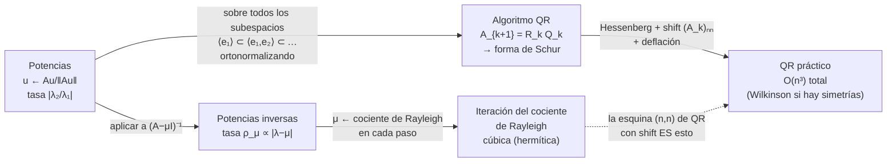
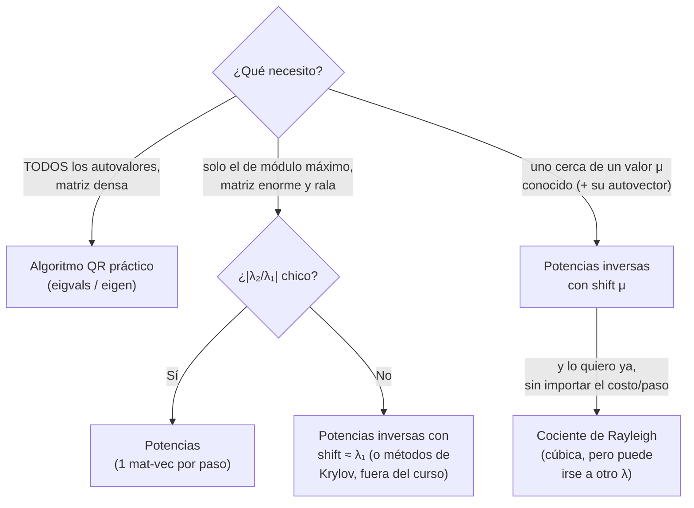

# Capítulo 7 - Métodos numéricos para problemas de autovalores

> [!idea]
> Pregunta central: ¿cómo calcular autovalores (y autovectores) si no existe fórmula cerrada? **Todo método es iterativo** (Abel). Tres herramientas, cada una construida sobre la anterior: **potencias** (multiplicar por $A$ amplifica el autovalor dominante), **potencias inversas** (multiplicar por $(A-\mu I)^{-1}$ amplifica el más cercano a $\mu$, con velocidad elegible) y **algoritmo QR** (hace potencias sobre todos los subespacios a la vez y converge a la forma de Schur; con Hessenberg + shifts + deflación es *el* algoritmo general, $O(n^3)$).

## Teoría

- [[Autovalores - repaso y por que los metodos son iterativos]] (7.1) - matriz compañera y Abel, autovectores a izquierda, multiplicidades, Jordan, hermíticas.
- [[Metodo de las potencias]] (7.2: Lema 7.1, Prop. 7.2, Obs. 7.3) - tasa $|\lambda_2/\lambda_1|$.
- [[Cociente de Rayleigh y criterio de parada]] (Obs. 7.4–7.6) - $\mu=\frac{x^HAx}{x^Hx}$, error cuadrático en hermíticas, residuo.
- [[Metodo de las potencias inversas]] (7.3: Prop. 7.7, Obs. 7.8–7.9) - tasa $\rho_\mu$; iteración del cociente de Rayleigh (cúbica).
- [[Algoritmo QR - definicion y convergencia]] (7.4: Teo. 7.10–7.11, Obs. 7.12–7.13) - $A^{k+1}=P_kU_k$; esquinas = potencias / potencias inversas.
- [[Algoritmo QR - Hessenberg, shifts y deflacion]] (7.4: eficiencia, Prop. 7.14, Wilkinson) - el algoritmo práctico.

## Problemas (7.1 a 7.15)

Ver [[Capitulo 7 - Problemas - Indice]].

## Teoremas y demostraciones

Ver [[Demostraciones - Capitulo 7]] (un archivo por resultado, en `Teoremas/`).

## Comparaciones

Ver [[Tablas Comparativas - Metodos para autovalores]].

## Genealogía de los métodos

## Mapa de decisión

## Conexión con el resto del curso

- **Capítulo 3:** el algoritmo QR usa la [[Matrices de Householder|factorización QR por Householder]] en cada paso; la reducción a Hessenberg también es Householder; el paso QR en Hessenberg cuesta $O(n^2)$ con [[Rotaciones de Givens|Givens]] ([[3.7 - Conteo Givens en Hessenberg|Problema 3.7]]). El cociente de Rayleigh es un problema de [[Minimos cuadrados y ecuaciones normales|mínimos cuadrados]] de una incógnita.
- **Capítulo 4:** la tasa del método de las potencias sale de la [[Teorema 4.24|fórmula de Gelfand]]; la diagonalización de hermíticas sale de [[Teorema 4.21|Schur]]; los métodos estacionarios convergen según $\rho(M)$, que es justamente lo que calcula el método de las potencias.
- **Capítulo 5:** $A_N$ es la matriz del [[Multigrid en 1D - problema modelo y suavizado|problema modelo]]; su $\kappa_2\sim N^2$ es lo que hace lento al método de las potencias. Arnoldi/GMRes construyen una Hessenberg y la factorizan incrementalmente con Givens, igual que el QR práctico.
- **Capítulo 6:** la iteración del cociente de Rayleigh es una iteración de tipo Newton para el problema de autovalores, y de ahí su convergencia de orden alto. Su orden se mide igual que en el [[6.10 - Orden experimental de Newton|Problema 6.10]].
